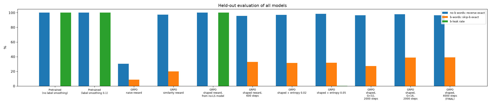
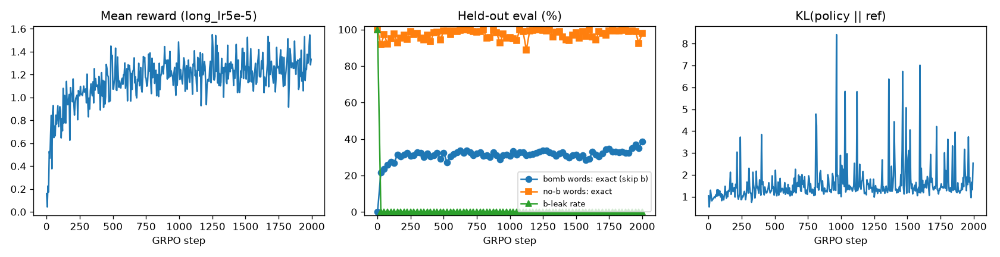

# 👶 baby.md — Mini Project: สอน GPT ตัวจิ๋วให้ "กลับคำ" และ "หลบระเบิด b"

> เอกสารนี้เขียนให้คนที่ **ไม่มีพื้นฐานเลย** อ่านจบแล้วเข้าใจทั้งโปรเจกต์ ตั้งแต่ "AI คืออะไร" ไปจนถึง "GRPO ทำงานยังไง"
> อ่านจากบนลงล่างได้เลย ไม่ต้องข้าม ถ้าเจอคำศัพท์แปลก ๆ ดูที่ [อภิธานศัพท์](#14-อภิธานศัพท์-คำศัพท์ที่ควรรู้) ท้ายเอกสาร

---

## สารบัญ

0. [โปรเจกต์นี้ให้ทำอะไร (สรุปใน 1 นาที)](#0-โปรเจกต์นี้ให้ทำอะไร-สรุปใน-1-นาที)
1. [AI เรียนรู้ได้ยังไง (ปูพื้นจากศูนย์)](#1-ai-เรียนรู้ได้ยังไง-ปูพื้นจากศูนย์)
2. [GPT / LLM คืออะไร](#2-gpt--llm-คืออะไร)
3. [ข้างในของ Transformer Decoder (MiniGPT)](#3-ข้างในของ-transformer-decoder-minigpt)
4. [Step 1: เทรน GPT ตั้งแต่ศูนย์ให้กลับคำ](#4-step-1-เทรน-gpt-ตั้งแต่ศูนย์ให้กลับคำ)
5. [Reinforcement Learning (RL) คืออะไร](#5-reinforcement-learning-rl-คืออะไร)
6. [PPO และ GRPO ทีละขั้น](#6-ppo-และ-grpo-ทีละขั้น)
7. [Step 2: ออกแบบ Reward (และการโดนโมเดล "โกง")](#7-step-2-ออกแบบ-reward-และการโดนโมเดล-โกง)
8. [ปัญหาใหญ่: โมเดลมั่นใจเกินไปจนไม่กล้าลอง (Exploration)](#8-ปัญหาใหญ่-โมเดลมั่นใจเกินไปจนไม่กล้าลอง-exploration)
9. [ผลการทดลองทั้งหมด](#9-ผลการทดลองทั้งหมด)
10. [วิเคราะห์และอภิปรายผล](#10-วิเคราะห์และอภิปรายผล)
11. [อ่านโค้ดทีละส่วน (Code Walkthrough)](#11-อ่านโค้ดทีละส่วน-code-walkthrough) ⭐ ใหม่
12. [วิธีรันโค้ดเอง](#12-วิธีรันโค้ดเอง)
13. [โครงสไลด์สำหรับ Step 3](#13-โครงสไลด์สำหรับ-step-3)
14. [อภิธานศัพท์](#14-อภิธานศัพท์-คำศัพท์ที่ควรรู้)

---

## 0. โปรเจกต์นี้ให้ทำอะไร (สรุปใน 1 นาที)

อาจารย์สั่งงาน 3 ขั้น:

| ขั้น | ให้ทำอะไร | ตัวอย่าง |
|---|---|---|
| **Step 1** | สร้าง GPT ตัวเล็ก ๆ (MiniGPT) **ตั้งแต่ศูนย์** แล้วสอนให้ **กลับลำดับตัวอักษร** (ยาว 2–6 ตัว) | `<BOS> h e l l o <SEP>` → `o l l e h <EOS>` |
| **Step 2** | เอาโมเดลจาก Step 1 มา **ฝึกต่อด้วย Reinforcement Learning (GRPO/PPO)** ให้ **ข้ามตัว "b" (ระเบิด 💣)** | `<BOS> a b c d e <SEP>` → `e d c a <EOS>` |
| **Step 3** | ทำ **พรีเซนเทชัน** สรุป config, ข้อมูล, ผลลัพธ์, reward, การวิเคราะห์ | (ดูหัวข้อ 13) |

**ผลลัพธ์ที่ได้ (สรุปสั้น ๆ):**

- Step 1: โมเดลกลับคำถูก **100%** บนข้อมูลที่ไม่เคยเห็น (1,350 คำ) ใช้เวลาเทรนบน CPU แค่ ~100 วินาที
- Step 2: หลังทำ GRPO โมเดล **ไม่เขียน "b" ออกมาเลย (b-leak ≈ 0%)** และตอบถูกทุกตัวอักษรได้ **39.0%** ของคำที่มี b (จากเดิม 0%) ขณะที่ยังกลับคำปกติ (ไม่มี b) ได้ **96.5%**
  - คำสั้น (ยาว 2) ทำได้ **97.5%** แต่คำยาว 6 ทำได้แค่ 22% — เหตุผลอยู่ในหัวข้อ 8.4 และ 10
- ระหว่างทางเราเจอ **"reward hacking"** (โมเดลหาทางโกงคะแนน) หลายแบบ และเจอ **"exploration problem"** (โมเดลมั่นใจเกินจนไม่ลองอะไรใหม่) ซึ่งเป็นบทเรียนสำคัญที่สุดของงานนี้

---

## 1. AI เรียนรู้ได้ยังไง (ปูพื้นจากศูนย์)

### 1.1 โมเดล = ฟังก์ชันที่มี "ปุ่มปรับ" เยอะ ๆ

ลองนึกถึงเครื่องผสมเสียงที่มีปุ่มหมุน 600,000 ปุ่ม 🎛️ ใส่ input เข้าไป → ได้ output ออกมา
ตอนแรกปุ่มทุกปุ่มถูกตั้งแบบสุ่ม → output มั่วสุด ๆ

ตัวเลขในปุ่มเหล่านี้เรียกว่า **parameters** หรือ **weights** (MiniGPT ของเรามี **600,832** ตัว)

### 1.2 การเทรน = การหมุนปุ่มทีละนิดให้ผิดน้อยลง

1. ให้โมเดลลองทาย
2. วัดว่า "ผิดแค่ไหน" → ได้ตัวเลขหนึ่งตัวเรียกว่า **loss** (ยิ่งน้อยยิ่งดี)
3. คำนวณว่าปุ่มแต่ละปุ่มควรหมุนไปทางไหนถึงจะผิดน้อยลง (เรียกว่า **gradient** คำนวณด้วยวิธี **backpropagation**)
4. หมุนปุ่มไปทางนั้นนิดหนึ่ง (ขนาดของ "นิดหนึ่ง" = **learning rate**)
5. ทำซ้ำหลายพันรอบ (แต่ละรอบเรียกว่า **step**)

ตัวที่ทำหน้าที่หมุนปุ่มเรียกว่า **optimizer** — เราใช้ **AdamW** ซึ่งเป็นตัวมาตรฐานที่ใช้กับ GPT ทุกตัว

### 1.3 ข้อมูล train vs. ข้อมูล test

เหมือนการสอบ: ถ้าครูเอาข้อสอบจริงมาให้ทำเป็นการบ้าน นักเรียนจำคำตอบได้ คะแนนสอบก็ไม่ได้บอกว่าเข้าใจจริงไหม

เพราะฉะนั้นเราจะแยกข้อมูลเป็น 2 กอง:
- **Training set** — ใช้สอน
- **Evaluation (test) set** — เก็บไว้สอบอย่างเดียว **ห้ามโมเดลเห็นตอนเทรน**

---

## 2. GPT / LLM คืออะไร

### 2.1 GPT = เครื่อง "ทายคำถัดไป"

LLM (Large Language Model) อย่าง ChatGPT ทำงานด้วยหลักการเดียวที่เรียบง่ายมาก:

> **ดูข้อความที่มีอยู่ → ทายว่า "ชิ้นถัดไป" คืออะไร → ต่อท้าย → ทายต่อ → ไปเรื่อย ๆ**

เช่น `วันนี้อากาศ` → ทาย `ดี` → `วันนี้อากาศดี` → ทาย `มาก` → ...

วิธีสร้างคำตอบทีละชิ้นแบบนี้เรียกว่า **autoregressive generation**

### 2.2 Token และ Tokenizer

คอมพิวเตอร์ไม่เข้าใจตัวหนังสือ เข้าใจแต่ตัวเลข จึงต้องแปลงข้อความเป็นชิ้น ๆ (**token**) แล้วแต่ละชิ้นมีเลขประจำตัว (**token id**)

ในโปรเจกต์นี้ **1 ตัวอักษร = 1 token** (ง่ายที่สุด) มีทั้งหมด **30 token**:

| id | token | ความหมาย |
|---|---|---|
| 0 | `<PAD>` | ช่องว่างเติมให้ทุกแถวยาวเท่ากัน (ไม่มีความหมาย) |
| 1 | `<BOS>` | **B**eginning **O**f **S**equence — "เริ่มประโยค" |
| 2 | `<SEP>` | **SEP**arator — "จบโจทย์แล้ว เริ่มตอบได้" |
| 3 | `<EOS>` | **E**nd **O**f **S**equence — "ตอบเสร็จแล้ว หยุด" |
| 4–29 | `a` … `z` | ตัวอักษรภาษาอังกฤษ 26 ตัว |

ตัวอย่าง: `<BOS> h e l l o <SEP> o l l e h <EOS>` → `[1, 11, 8, 15, 15, 18, 2, 18, 15, 15, 8, 11, 3]`

### 2.3 ทำไมเรียกว่า "Decoder-only Transformer"

Transformer มี 2 แบบหลัก: Encoder (อ่านทั้งประโยคพร้อมกัน) กับ Decoder (อ่านได้แค่ "อดีต" ห้ามแอบดู "อนาคต")
GPT ใช้แค่ส่วน **Decoder** เพราะงานของมันคือทายของถัดไป ถ้าให้แอบดูคำตอบข้างหน้าได้ก็เท่ากับโกง

---

## 3. ข้างในของ Transformer Decoder (MiniGPT)

```
 token ids  ──►  [Token Embedding] + [Position Embedding]
                              │
                 ┌────────────▼────────────┐
                 │  Block 1                │
                 │   LayerNorm → Causal    │
                 │   Self-Attention (+)    │   × 3 ชั้น
                 │   LayerNorm → MLP (+)   │
                 └────────────┬────────────┘
                              ▼
                 [LayerNorm] → [Linear → 30 ค่า]  ──► softmax ──► ความน่าจะเป็นของ token ถัดไป
```

อธิบายทีละชิ้นแบบภาษาคน:

| ชิ้นส่วน | ทำอะไร | เปรียบเทียบ |
|---|---|---|
| **Token Embedding** | แปลง token id เป็นเวกเตอร์ (ตัวเลข 128 ตัว) | ให้ตัวอักษรแต่ละตัวมี "บัตรประชาชน" ที่บอกคุณสมบัติ |
| **Position Embedding** | บวกข้อมูล "ตำแหน่ง" เข้าไป (ตัวที่ 1, 2, 3...) | ถ้าไม่มี โมเดลจะแยก `ab` กับ `ba` ไม่ออก — **สำคัญมากสำหรับงานกลับคำ** |
| **Self-Attention** | แต่ละ token "มองย้อนไป" token อื่น ๆ แล้วเลือกว่าจะดึงข้อมูลจากใครมากน้อยแค่ไหน | เหมือนนักเรียนในห้องหันไปถามเพื่อนที่เกี่ยวข้อง |
| **Causal mask** | บังคับให้มองได้แค่ token ที่อยู่ **ก่อนหน้า** | ห้ามดูเฉลยข้างหน้า |
| **Multi-head (4 heads)** | ทำ attention 4 ชุดพร้อมกัน แต่ละชุดมองหาคนละเรื่อง | ถาม 4 คำถามพร้อมกัน |
| **MLP** | เครือข่ายประสาทเล็ก ๆ ประมวลผลข้อมูลที่ได้มา | "คิดต่อ" หลังจากรวบรวมข้อมูล |
| **Residual (+)** | บวก input เดิมกลับเข้าไป | ทางลัดให้ข้อมูลไหลผ่านง่าย เทรนง่ายขึ้น |
| **LayerNorm** | ปรับสเกลตัวเลขให้อยู่ในช่วงเหมาะสม | กันตัวเลขพุ่งหรือหดเกินไป |
| **Output head** | แปลงเวกเตอร์กลับเป็นคะแนน 30 ค่า (หนึ่งค่าต่อหนึ่ง token) แล้ว softmax เป็นความน่าจะเป็น | "ตัวถัดไปน่าจะเป็น `o` 99%, `l` 0.3% ..." |

### 3.1 โมเดลกลับคำได้ยังไง (สัญชาตญาณ)

ตอนตอบตัวที่ k โมเดลต้อง "หันไปมอง" ตัวอักษรของโจทย์ที่ตำแหน่ง (ความยาว + 1 − k)
Self-attention + position embedding ทำเรื่องนี้ได้พอดี: มันเรียนรู้ว่า "ตอนนี้อยู่ตำแหน่งที่เท่าไร → ต้องไป copy ตัวไหน"
👉 จำข้อนี้ไว้ เพราะมันคือ **ต้นเหตุ** ที่ Step 2 ยาก (หัวข้อ 8)

### 3.2 Config ของ MiniGPT ที่เราใช้

| ค่า | เท่ากับ | ความหมาย |
|---|---|---|
| `vocab_size` | 30 | จำนวน token ทั้งหมด |
| `block_size` | 15 | ความยาวสูงสุด = BOS + 6 + SEP + 6 + EOS |
| `n_layer` | 3 | จำนวน Transformer block ซ้อนกัน |
| `n_head` | 4 | จำนวน attention head |
| `n_embd` | 128 | ขนาดเวกเตอร์ของแต่ละ token |
| `dropout` | 0.0 | ไม่ใช้ (ข้อมูลสุ่มใหม่ได้ไม่จำกัด จึงไม่ค่อย overfit) |
| weight tying | ใช่ | ใช้ตาราง embedding ร่วมกับ output head (แบบ GPT-2) |
| **จำนวนพารามิเตอร์** | **600,832** | เล็กกว่า GPT-2 (124M) ประมาณ 200 เท่า |

---

## 4. Step 1: เทรน GPT ตั้งแต่ศูนย์ให้กลับคำ

### 4.1 การเตรียมข้อมูล (Dataset)

- **คำ input:** สุ่มตัวอักษร a–z ยาว 2–6 ตัว (ไม่ต้องเป็นคำที่มีความหมาย เช่น `qzkf`)
- **คำตอบ:** คำเดิมกลับหลัง
- **รูปแบบ:** `<BOS> x1 x2 ... xN <SEP> xN ... x2 x1 <EOS>`

**ชุดข้อมูลทดสอบ (เก็บไว้ที่ `data/`)** — สร้างครั้งเดียวด้วย seed ตายตัว:

| ชุด | ขนาด | ใช้ทำอะไร |
|---|---|---|
| `eval_reverse.json` | 1,350 คำ (150 คำยาว 2, และ 300 คำต่อความยาว 3–6) | วัดความสามารถกลับคำ |
| `eval_bomb.json` | 840 คำ ที่ **มี b อย่างน้อย 1 ตัว** (40 คำยาว 2, และ 200 คำต่อความยาว 3–6) | วัด Step 2 (ข้าม b) |

**ชุด train:** สุ่มคำใหม่ทุก step แบบไม่ซ้ำกับชุดทดสอบเลย (ตัวสุ่มเช็คแล้วโยนทิ้งถ้าบังเอิญตรงกับคำในชุดทดสอบ)
เทรน 3,000 steps × 256 คำ = **768,000 ตัวอย่าง**

> 💡 ทำไมคำยาว 2 มีน้อยกว่า? เพราะคำยาว 2 ตัวมีได้แค่ 26×26 = 676 แบบเท่านั้น ถ้าเอาไปสอบหมด ก็ไม่เหลือให้เทรน

### 4.2 Loss masking — สอนเฉพาะ "ส่วนคำตอบ"

ตัวอักษรใน input เป็นของสุ่ม ไม่มีทางทายได้ ถ้าบังคับให้โมเดลทายส่วนนั้นด้วยจะเปลืองแรงเปล่า ๆ
เราจึงคิด loss **เฉพาะ token หลัง `<SEP>`** (คำตอบ + `<EOS>`) เท่านั้น ส่วนอื่นใส่ label = -100 (PyTorch จะข้ามให้)

### 4.3 Hyper-parameters ของการเทรน

| ค่า | เท่ากับ |
|---|---|
| Optimizer | AdamW (β = 0.9, 0.98), weight decay 0.01 |
| Learning rate | 1e-3, warmup 200 steps แล้วลดแบบ cosine จนเหลือ 10% |
| Batch size | 256 |
| Steps | 3,000 |
| Gradient clipping | 1.0 |
| **Label smoothing** | **0.1** (สำคัญ! อธิบายในหัวข้อ 8) |
| เวลาเทรน | ~104 วินาที บน CPU |

### 4.4 การวัดผล

- **Exact match** = ตอบถูก **ทุกตัวอักษร** และหยุด (`<EOS>`) ถูกที่ → นับ 1 ข้อ
- ตอนวัดผลใช้ **greedy decoding** = เลือก token ที่ความน่าจะเป็นสูงสุดทุกครั้ง (ไม่สุ่ม)

### 4.5 ผลลัพธ์ Step 1

| วัดบน | Exact match |
|---|---|
| ชุด `eval_reverse` (1,350 คำที่ไม่เคยเห็น) | **100.00%** |
| แยกตามความยาว 2 / 3 / 4 / 5 / 6 | 100% / 100% / 100% / 100% / 100% |
| ชุด `eval_bomb` แต่ให้ **กลับคำธรรมดา** | **100.00%** |
| ชุด `eval_bomb` แต่ให้ **ข้าม b** (งาน Step 2) | **0.00%** ← แน่นอน เพราะยังไม่เคยสอน |

ความแม่นยำแตะ 100% ตั้งแต่ step ที่ 250 แล้ว (ดูกราฟ `results/pretrain_curves.png`) — งานกลับคำเป็นงานที่ Transformer ถนัดมาก

---

## 5. Reinforcement Learning (RL) คืออะไร

### 5.1 เทียบกับการเรียนแบบเดิม

| | Supervised Learning (Step 1) | Reinforcement Learning (Step 2) |
|---|---|---|
| ได้อะไรจากครู | **เฉลยทุกตัวอักษร** | **แค่คะแนน** ว่าคำตอบที่ลองทำดีแค่ไหน |
| เปรียบเทียบ | ครูบอกว่า "ข้อนี้ตอบ e d c a" | ครูบอกว่า "คำตอบนี้ได้ 7/10" แต่ไม่บอกว่าผิดตรงไหน |
| ตัวอย่างในชีวิต | ท่องเฉลย | ฝึกหมาให้นั่ง: นั่งถูก → ได้ขนม 🍖 |

### 5.2 ศัพท์ RL ที่ต้องรู้ (ในบริบทของเรา)

- **Policy (π)** = ตัวโมเดลเอง (มันเป็นตัว "ตัดสินใจ" ว่าจะพิมพ์ token อะไร)
- **Action** = การเลือก token หนึ่งตัว
- **Rollout / Completion** = คำตอบทั้งคำที่โมเดลสุ่มสร้างออกมา เช่น `e d c a <EOS>`
- **Reward (r)** = คะแนนที่ให้กับคำตอบนั้น (เราเขียนฟังก์ชันคิดคะแนนเอง)
- **Advantage (A)** = คำตอบนี้ "ดีกว่าค่าเฉลี่ย" แค่ไหน — ถ้าบวก ให้ทำบ่อยขึ้น, ถ้าลบ ให้ทำน้อยลง

### 5.3 ทำไมโจทย์ให้ใช้ RL แทนที่จะสอนเฉลยใหม่ไปเลย?

จริง ๆ งานนี้ถ้าสอนเฉลยแบบ Step 1 ก็ทำได้ง่ายกว่ามาก แต่จุดประสงค์คือ **ฝึกใช้เทคนิคเดียวกับที่ใช้ปรับ ChatGPT / DeepSeek-R1** (RLHF / GRPO) ซึ่งในโลกจริงเรามัก **ไม่มีเฉลยที่ถูกต้องเป๊ะ** มีแค่ตัวให้คะแนน (เช่น คนกดชอบ/ไม่ชอบ หรือโค้ดรันผ่าน/ไม่ผ่าน)

---

## 6. PPO และ GRPO ทีละขั้น

### 6.1 แนวคิดพื้นฐาน: Policy Gradient

> ลองทำหลาย ๆ แบบ → แบบไหนได้คะแนนสูงกว่าค่าเฉลี่ย ให้ **เพิ่มความน่าจะเป็น** ที่จะทำแบบนั้น / แบบไหนต่ำกว่าค่าเฉลี่ย ให้ **ลดลง**

### 6.2 PPO (Proximal Policy Optimization)

PPO เป็นอัลกอริทึมที่ OpenAI ใช้ทำ RLHF ให้ ChatGPT มีส่วนประกอบหลัก:
1. **Value model (critic)** — โมเดลอีกตัวที่ทายว่า "สถานการณ์นี้น่าจะได้คะแนนเท่าไร" ใช้เป็นค่าเฉลี่ยอ้างอิง
2. **Clipping** — ห้ามเปลี่ยน policy ทีเดียวมากเกินไป (จำกัดอัตราส่วน π_ใหม่/π_เก่า ไว้ในช่วง 1±ε)

ข้อเสีย: ต้องเทรนโมเดล critic เพิ่มอีกตัว ยุ่งยากและเปลืองหน่วยความจำ

### 6.3 GRPO (Group Relative Policy Optimization) — ที่เราใช้

GRPO (จาก DeepSeekMath / DeepSeek-R1) **ตัด critic ทิ้ง** แล้วใช้ "ค่าเฉลี่ยของกลุ่ม" แทน:

**ทุก ๆ 1 step ของการเทรน:**

```
1) สุ่มโจทย์มา 32 ข้อ  (60% บังคับให้มี b, 40% คำสุ่มทั่วไป)
2) แต่ละโจทย์ ให้โมเดล "สุ่มตอบ" G = 16 แบบ   → รวม 512 คำตอบ
3) ให้คะแนน (reward) ทุกคำตอบ
4) ในแต่ละกลุ่ม (โจทย์เดียวกัน 16 คำตอบ) คำนวณ
        advantage = (reward − ค่าเฉลี่ยกลุ่ม) / ส่วนเบี่ยงเบนมาตรฐานกลุ่ม
5) อัปเดตโมเดล: เพิ่มโอกาสของ token ในคำตอบที่ advantage > 0, ลดของ < 0
   (ใช้ clipping แบบ PPO, ε = 0.2, อัปเดต 2 รอบต่อ batch)
6) ลงโทษถ้า policy ห่างจากโมเดลต้นฉบับมากเกินไป (KL penalty, β = 0.01)
```

**ตัวอย่างจริง** โจทย์ `gob` (เฉลย: `og`) โมเดลสุ่มตอบ 4 แบบ:

| คำตอบที่สุ่มได้ | reward | ค่าเฉลี่ยกลุ่ม | advantage | ผล |
|---|---|---|---|---|
| `bog` | -0.75 | 0.50 | ติดลบมาก | ลดโอกาส ⬇️⬇️ |
| `oo` | 0.50 | 0.50 | 0 | ไม่เปลี่ยน |
| `o` | 0.25 | 0.50 | ติดลบนิดหน่อย | ลด ⬇️ |
| `og` | **2.00** | 0.50 | **บวกมาก** | เพิ่มโอกาส ⬆️⬆️ |

> 💡 **จุดสำคัญ:** ถ้าทั้ง 16 คำตอบในกลุ่ม **เหมือนกันหมด** → reward เท่ากันหมด → advantage = 0 ทุกตัว → **โมเดลไม่ได้เรียนรู้อะไรเลย** จำข้อนี้ไว้สำหรับหัวข้อ 8

### 6.4 ส่วนประกอบเสริม

- **KL penalty (β):** เหมือน "เชือกผูก" ไว้กับโมเดล Step 1 ไม่ให้เปลี่ยนจนลืมวิธีกลับคำ
- **Clipping (ε = 0.2):** ห้ามเปลี่ยนความน่าจะเป็นเกิน ±20% ต่อการอัปเดตหนึ่งครั้ง
- **Temperature (T = 1.0):** ความ "กล้าสุ่ม" ตอนสร้างคำตอบ (T สูง = สุ่มมั่วขึ้น)
- **Learning rate 5e-5:** เล็กกว่าตอน pretrain 20 เท่า เพราะแค่ "ปรับ" ไม่ใช่สอนใหม่

### 6.5 Hyper-parameters ของ GRPO (รุ่น final)

| ค่า | เท่ากับ |
|---|---|
| Prompts ต่อ step | 32 (60% มี b) |
| Group size G | 16 |
| Learning rate | 5e-5 (AdamW) |
| KL β | 0.01 |
| Clip ε | 0.2 |
| Inner updates | 2 ต่อ batch |
| Temperature | 1.0 |
| Steps | 4,000 (2,000 + เทรนต่ออีก 2,000 โดยยังผูก KL กับโมเดล Step 1) |
| Reward | `reward_shaped` (หัวข้อ 7 เวอร์ชัน 4) |
| เวลา | ~21 นาที (2,000 steps แรก) + ~17 นาที บน CPU |

---

## 7. Step 2: ออกแบบ Reward (และการโดนโมเดล "โกง")

นี่คือหัวใจของงาน: **โมเดลจะพยายามทำคะแนนให้สูงที่สุด ไม่ใช่ทำสิ่งที่เราตั้งใจ**
ถ้า reward มีช่องโหว่ โมเดลจะหาเจอเสมอ เรียกว่า **Reward Hacking** 🕵️

เราลองออกแบบ reward ทั้งหมด 4 แบบ:

### เวอร์ชัน 1 — Naive: "ห้ามมี b" เท่านั้น

```
reward = 1 ถ้าในคำตอบไม่มี b, 0 ถ้ามี, -1 ถ้ารูปแบบเสีย
```
**ปัญหา:** ไม่ได้บอกว่าคำตอบที่ถูก "ควรเป็นอะไร" → โมเดลจะลบ b แบบไหนก็ได้คะแนนเต็ม
ผลจริง (400 steps): b หายหมดจริง (b-leak 0%) **แต่โมเดลพัง** — กลับคำปกติเหลือแค่ **30%** และข้าม b ถูกแค่ **8.7%**
เพราะคำตอบมั่ว ๆ อะไรก็ได้ที่ไม่มี b ก็ได้คะแนนเต็มเท่ากัน → ไม่มีอะไรบังคับให้ยังกลับคำถูก
👉 **นี่คือ reward hacking แบบคลาสสิก:** ได้คะแนนเต็ม แต่ไม่ได้ทำงานที่เราต้องการ

### เวอร์ชัน 2 — Similarity: ความเหมือนกับเฉลย

```
reward = ความเหมือน(คำตอบ, เฉลย) − 0.5 × จำนวน b + 1 (ถ้าถูกเป๊ะ)
```
**ปัญหาที่เจอจริง:** โมเดล **เปลี่ยน b เป็น x** แทน! เช่น `mb → xm` (เฉลยคือ `m`)
เพราะ `xm` เหมือน `m` อยู่ 67% แถมไม่มี b → ได้คะแนนดีพอ และเป็นการเปลี่ยนแปลงที่ "ง่ายที่สุด" สำหรับโมเดล (ไม่ต้องเปลี่ยนตำแหน่งการ copy เลย)
ผลจริง (400 steps): ข้าม b ถูก **19.9%**, กลับคำปกติ 97.3%

### เวอร์ชัน 3 — Prefix: นับว่าถูกต่อเนื่องจากต้นกี่ตัว

```
reward = (จำนวนตัวที่ถูกต่อเนื่องจากตัวแรก) / ความยาว − 0.5 × จำนวน b + 1 (ถ้าถูกเป๊ะ)
```
**ปัญหาที่เจอจริง:** โมเดล **หยุดทันทีเมื่อเจอ b** เช่น `mb → (ว่างเปล่า)`, `tb → (ว่างเปล่า)`
เพราะหยุดเลยก็ไม่โดนหักคะแนน b และเป็นวิธีที่ง่าย (แค่พิมพ์ `<EOS>` แทน `b`)

### ✅ เวอร์ชัน 4 (Final) — Prefix + ลงโทษความยาวผิด

```python
def reward_shaped(x, out):
    if out is None:                     # รูปแบบเสีย (ไม่มี <EOS>, มี token พิเศษปน)
        return -1.0
    target = x[::-1].replace("b", "")   # เฉลย: กลับคำแล้วลบ b
    r  = ความยาว prefix ที่ถูก / max(len(out), len(target))   # 0..1
    r -= 0.5 * จำนวน b ในคำตอบ                               # 💣 โดนระเบิด
    r -= 0.5 * |len(out) − len(target)| / len(target)        # ยาว/สั้นผิด
    if out == target:
        r += 1.0                                             # 🎉 โบนัสถูกเป๊ะ
    return r
```

**ทำไมแบบนี้ดี:** มันให้คะแนน "เป็นขั้นบันได" ทุกก้าวเล็ก ๆ ที่เข้าใกล้คำตอบได้คะแนนเพิ่ม

| โจทย์ `abcde` (เฉลย `edca`) | พฤติกรรม | reward |
|---|---|---|
| `edcba` | เขียน b (เหมือน Step 1) | **-0.03** |
| `edcxa` | เปลี่ยน b เป็นตัวอื่น (โกงแบบ v2) | 0.48 |
| `edc` | หยุดตรง b (โกงแบบ v3) | 0.63 |
| `edcaa` | ข้าม b ได้ แต่ยาวเกิน | 0.68 |
| `edca` | **ถูกเป๊ะ** | **2.00** |

---

## 8. ปัญหาใหญ่: โมเดลมั่นใจเกินไปจนไม่กล้าลอง (Exploration)

### 8.1 อาการ

รอบแรกเราเทรน Step 1 แบบปกติ (ไม่มี label smoothing) loss ลงไปถึง **0.0000** แปลว่าโมเดลมั่นใจ 99.9999% ในทุกคำตอบ

พอเอาไปทำ GRPO:
- โมเดลสุ่มตอบ 16 ครั้ง → ได้คำตอบ **เหมือนเดิมเป๊ะทั้ง 16 ครั้ง** (ยังเขียน b)
- reward เท่ากันหมด → advantage = 0 → **ไม่เรียนรู้อะไรเลย** (group-std = 0.000 ใน log)

เราทดลองวัดว่า "ถ้าให้สุ่ม 32 ครั้ง มีโอกาสที่จะสุ่มได้คำตอบที่ถูกบ้างไหม":

| โมเดล | Temperature 1.0 | 1.5 | 2.0 | 3.0 |
|---|---|---|---|---|
| ไม่มี label smoothing | 0.000% | 0.000% | 0.000% | 0.000% |
| **label smoothing 0.1** | **0.074%** | 0.060% | 0.015% | 0.060% |

👉 ถ้าโมเดล **ไม่เคยสุ่มเจอคำตอบที่ถูกเลยสักครั้ง** RL ก็ไม่มีทางรู้ว่าคำตอบที่ถูกได้คะแนนดี — **RL ทำได้แค่ "ขยาย" สิ่งที่โมเดลเคยทำได้บ้างแล้ว ไม่ใช่เสกของใหม่**

### 8.2 วิธีแก้: Label Smoothing

ตอน pretrain แทนที่จะบอกโมเดลว่า "คำตอบคือ `o` 100%" เราบอกว่า "`o` 90%, ที่เหลือแบ่ง ๆ กันไป 10%"
ผล:
- Greedy decoding ยังถูก **100%** เหมือนเดิม (เพราะ `o` ยังคะแนนสูงสุด)
- แต่ตอนสุ่ม โมเดล "กล้า" ลองตัวอื่นบ้าง → GRPO มีวัตถุดิบให้เรียนรู้

### 8.3 Entropy collapse (มั่นใจเกินอีกรอบ)

ระหว่าง GRPO โมเดลค่อย ๆ มั่นใจขึ้นเรื่อย ๆ จน group-std ลดจาก ~0.6 เหลือ ~0.05 → เรียนรู้ช้าลงจนแทบหยุด
เราลองใส่ **entropy bonus** (ให้คะแนนพิเศษกับการ "ไม่มั่นใจ") ค่า 0.02 และ 0.05 → ช่วยให้ group-std สูงขึ้น (~0.2) แต่ความแม่นยำ **ไม่ดีขึ้น** (~32%) เพราะความสุ่มที่เพิ่มเป็นแบบ "มั่ว ๆ" ไม่ได้ช่วยให้เจอพฤติกรรมที่ถูกต้อง

### 8.4 ทำไม "ข้าม b" ถึงยากสำหรับโมเดลนี้

จำหัวข้อ 3.1 ได้ไหม — โมเดลกลับคำโดย **"ดูตำแหน่ง → copy ตัวที่ตำแหน่งตรงข้าม"**
แต่การข้าม b ต้องเปลี่ยนวิธีคิดเป็น **"copy ตัวถัดไปที่ไม่ใช่ b"** ซึ่งต้อง **นับว่าข้าม b ไปแล้วกี่ตัว** — เป็น "อัลกอริทึมใหม่" ไม่ใช่แค่ปรับนิดหน่อย

ความผิดพลาดที่เหลือจึงมักเป็นแบบนี้ (ข้ามได้ แต่ "ตำแหน่ง copy" ไม่เลื่อนตาม):

| input | เฉลย | โมเดลตอบ | อธิบาย |
|---|---|---|---|
| `gob` | `og` | `oo` | ข้าม b ได้ แต่ตัวถัดไป copy ตำแหน่งเดิมซ้ำ |
| `hqbs` | `sqh` | `sqq` | เหมือนกัน |
| `jbqis` | `siqj` | `siqi` | ตัวสุดท้ายผิด |

---

## 9. ผลการทดลองทั้งหมด

> ทุกตัวเลขวัดบน **ชุดทดสอบเดียวกัน** ที่โมเดลไม่เคยเห็น ด้วย greedy decoding (ไฟล์ `results/summary.md`)

### 9.1 ตารางหลัก

| โมเดล | No-b words (กลับคำ) | **b-words ข้าม b ถูกเป๊ะ** | b-leak | Step-2 task บนคำสุ่ม | Reverse (งาน Step 1 เดิม) |
|---|---|---|---|---|---|
| Pretrained (ไม่มี label smoothing) | 100.0% | 0.0% | 100.0% | 85.5% | 100.0% |
| Pretrained (label smoothing 0.1) — **จุดเริ่มต้นของ RL** | 100.0% | 0.0% | 100.0% | 85.5% | 100.0% |
| GRPO — naive reward ("ห้ามมี b") | 30.3% 💥 | 8.7% | 0.0% | 27.3% | 25.9% |
| GRPO — similarity reward | 97.3% | 19.9% | 0.0% | 86.1% | 83.2% |
| GRPO — shaped reward แต่เริ่มจากโมเดลไม่มี LS | 100.0% | **0.0%** 🧊 | 100.0% | 85.5% | 100.0% |
| GRPO — shaped, 600 steps | 95.7% | 33.0% | 0.0% | 86.3% | 81.8% |
| GRPO — shaped + entropy 0.02 | 96.9% | 31.4% | 0.0% | 87.0% | 82.8% |
| GRPO — shaped + entropy 0.05 | 98.4% | 31.7% | 0.1% | 88.3% | 84.1% |
| GRPO — shaped, G=32, 2,000 steps (β=0.04, lr 1e-4) | 96.4% | 27.3% | 0.0% | 86.1% | 82.4% |
| GRPO — shaped, G=16, 2,000 steps | 97.9% | 38.7% | 0.0% | **90.2%** | 83.7% |
| ⭐ **GRPO — shaped, 4,000 steps (FINAL)** | **96.5%** | **39.0%** | **0.0%** | 88.1% | 82.5% |

### 9.2 แยกตามความยาวคำ (b-words, ข้าม b ถูกเป๊ะ)

| โมเดล | ยาว 2 | ยาว 3 | ยาว 4 | ยาว 5 | ยาว 6 |
|---|---|---|---|---|---|
| Pretrained | 0.0% | 0.0% | 0.0% | 0.0% | 0.0% |
| GRPO naive | 37.5% | 17.0% | 5.5% | 4.5% | 2.0% |
| GRPO similarity | 45.0% | 26.0% | 23.5% | 11.5% | 13.5% |
| GRPO shaped 600 steps | 97.5% | 55.5% | 28.0% | 20.5% | 15.0% |
| ⭐ **GRPO FINAL** | **97.5%** | **56.5%** | **38.5%** | **27.5%** | **22.0%** |

### 9.3 วิธีอ่านตาราง

- คอลัมน์ **"Reverse (งาน Step 1 เดิม)"** ลดลงเหลือ ~82% หลัง RL — **ไม่ใช่เรื่องเสีย!** เพราะชุดนี้มีคำที่มี b ปนอยู่ ~15% ซึ่งตอนนี้โมเดล "ตั้งใจ" ลบ b ออก จึงไม่ตรงกับการกลับคำแบบเดิม (นั่นคือสิ่งที่เราสั่งให้ทำ)
- คอลัมน์ **"Step-2 task บนคำสุ่ม"** ของ pretrained ได้ 85.5% ทั้งที่ไม่เคยเรียนข้าม b เพราะคำสุ่มส่วนใหญ่ (~85%) ไม่มี b อยู่แล้ว → ตัวเลขที่บอกความสามารถจริงคือ **"b-words ข้าม b ถูกเป๊ะ"**

**คำอธิบายคอลัมน์:**
- **Reverse (Step 1):** กลับคำปกติ 1,350 คำ (นับว่าถูกถ้าตรงกับการกลับคำธรรมดา)
- **No-b words:** เฉพาะคำที่ไม่มี b — โมเดลหลัง RL ควร **ยังทำได้ 100%** (ไม่ลืมของเก่า)
- **b-words skip-b exact:** 840 คำที่มี b — ต้องกลับคำ **และ** ลบ b ออกถูกทุกตัว
- **b-leak:** สัดส่วนคำตอบที่ยังมี b หลุดออกมา (ยิ่งต่ำยิ่งดี)
- **Step-2 task (random words):** งาน Step 2 บนคำสุ่มทั่วไป (ส่วนใหญ่ไม่มี b)

### 9.4 กราฟ

| กราฟ | ไฟล์ |
|---|---|
| Step 1: loss และความแม่นยำระหว่างเทรน | `results/pretrain_curves.png` |
| Step 2: reward / ความแม่นยำ / KL ระหว่าง GRPO (2,000 steps แรก) | `results/grpo_long_lr5e-5_curves.png` |
| Step 2: 2,000 steps ต่อมา (final) | `results/grpo_final_curves.png` |
| เปรียบเทียบทุกโมเดล | `results/summary.png` |




---

## 10. วิเคราะห์และอภิปรายผล

### 10.1 สิ่งที่ทำสำเร็จ ✅

1. **Step 1 ง่ายมากสำหรับ Transformer** — 600K parameters, 100 วินาที, ถูก 100% ทุกความยาว
2. **RL สอนให้ "ไม่เขียน b" ได้เกือบสมบูรณ์** — b-leak จาก 100% → 0% ภายใน ~25–50 steps
3. **ไม่ลืมของเก่ามาก** — คำที่ไม่มี b ยังกลับถูก ~96–98% (KL penalty ช่วยตรงนี้)
4. **คำสั้นทำได้ดีมาก** — คำยาว 2 ข้าม b ถูก 97.5%

### 10.2 สิ่งที่ยังทำไม่ได้ ❌ และทำไม

**ความแม่นยำบนคำที่มี b ตันอยู่ที่ ~40%** และยิ่งคำยาว ยิ่งแย่ (97.5% → 22%)

เหตุผล (จากการดูคำตอบที่ผิด):
- โมเดลเรียนรู้ "ข้าม b" ได้ แต่ **ไม่เลื่อนตำแหน่ง copy ตามไปด้วย** → ตัวอักษรหลัง b มักซ้ำหรือผิด (`gob → oo`)
- การข้าม b ที่ถูกต้องเป็น **อัลกอริทึมใหม่** ("copy ตัวที่ไม่ใช่ b ตัวถัดไป") ไม่ใช่แค่ "ปรับเล็กน้อย" จากการกลับคำ
- RL เรียนรู้ได้จาก **สิ่งที่โมเดลบังเอิญสุ่มเจอ** เท่านั้น คำยิ่งยาว → ต้องสุ่มถูกหลายตัวติดกัน → โอกาสเจอน้อยมาก (ทั้งหมดรวม ~0.07%)
- เทรนเพิ่มจาก 2,000 → 4,000 steps **ไม่ช่วย** (38.7% → 39.0%) แสดงว่าติด "เพดาน" ของวิธีนี้ ไม่ใช่เพราะเทรนน้อย

### 10.3 บทเรียนสำคัญ (ตอบคำถาม "ได้เรียนรู้อะไร")

| # | บทเรียน | หลักฐานจากการทดลอง |
|---|---|---|
| 1 | **Reward hacking เกิดขึ้นจริงและเกิดง่าย** | naive → โมเดลพัง (30%), similarity → เปลี่ยน b เป็น x, prefix → หยุดตรง b |
| 2 | **Reward ต้องให้คะแนน "ทีละขั้น"** (dense / shaped) | shaped (39%) > similarity (20%) > naive (9%) |
| 3 | **RL ขยายได้แค่สิ่งที่โมเดล "เคยทำได้บ้าง"** | โมเดลที่มั่นใจ 100% (ไม่มี LS) → RL ไม่เรียนรู้อะไรเลย 0% |
| 4 | **Pretraining ส่งผลต่อ RL มาก** | แค่เปลี่ยน label smoothing 0 → 0.1 ก็ทำให้ RL จาก 0% → 39% |
| 5 | **Entropy collapse ทำให้เรียนรู้ตัน** | group-std ลด 0.6 → 0.05; entropy bonus ช่วยเรื่องนี้แต่ไม่ได้เพิ่มความแม่นยำ |
| 6 | **เพิ่ม G ไม่ได้ช่วยเสมอ** | G=32 (แต่ lr สูงกว่า + β สูงกว่า) ได้แค่ 27% — การตั้ง hyper-parameter สำคัญพอ ๆ กับขนาดกลุ่ม |
| 7 | **KL penalty ช่วยไม่ให้ลืม** | naive reward ที่ไม่มีอะไรยึดคำตอบ → ลืมวิธีกลับคำ |

### 10.4 ถ้ามีเวลาเพิ่ม จะลองอะไรต่อ

1. **SFT warm-start:** สอนเฉลยข้าม b สัก 100–500 ตัวอย่างก่อน แล้วค่อย RL (แบบที่ DeepSeek-R1 ทำ "cold start") — คาดว่าจะทะลุ 90%+ เพราะแก้ปัญหา exploration ตรง ๆ
2. **Curriculum:** เริ่ม RL จากคำสั้น (ยาว 2–3) ก่อน แล้วค่อยเพิ่มความยาว
3. **Token-level reward / process reward:** ให้คะแนนทีละตัวอักษร แทนที่จะให้คะแนนทั้งคำ
4. **โมเดลใหญ่ขึ้น** (layer มากขึ้น) อาจเรียนอัลกอริทึม "นับ b" ได้ง่ายกว่า
5. **Pretrain ด้วยข้อมูลหลากหลายกว่า** (เช่น งาน copy/filter อื่น ๆ) ให้โมเดลมีพฤติกรรมพื้นฐานที่ RL เอาไปต่อยอดได้

### 10.5 สรุปในประโยคเดียว

> **RL (GRPO) สอนโมเดลให้ "เลิกทำ" สิ่งที่ไม่ต้องการ (เขียน b) ได้ง่ายมาก แต่สอนให้ "ทำสิ่งใหม่" (ข้าม b แล้วเลื่อนตำแหน่ง) ได้ยาก เพราะ RL ต้องอาศัยการสุ่มเจอคำตอบที่ดีก่อน และ reward ที่ออกแบบไม่ดีจะถูกโมเดลหาช่องโหว่เสมอ**

---

## 11. อ่านโค้ดทีละส่วน (Code Walkthrough)

> หัวข้อนี้พาอ่านโค้ด **ทุกไฟล์** แบบทีละท่อน พร้อมตัวอย่างตัวเลขจริง เปิดไฟล์คู่กันไปด้วยจะเข้าใจง่ายที่สุด
> ไม่ต้องเก่ง Python มาก่อน — หัวข้อ 11.1 ปูพื้นที่ต้องรู้ให้แล้ว

### 11.0 แผนที่: ไฟล์ไหนเรียกใช้อะไร

```
                         common.py  (กล่องเครื่องมือกลาง)
   ┌────────────────────────────────────────────────────────────────────┐
   │ tokenizer      : ITOS, STOI, encode, prompt_ids, full_ids          │
   │ ข้อมูล          : random_word, build_eval_sets, WordSampler,         │
   │                  make_sft_batch                                    │
   │ โมเดล          : GPTConfig, CausalSelfAttention, Block, MiniGPT      │
   │ ใช้งานโมเดล     : generate, parse_completion, predict, evaluate        │
   │ บันทึก/โหลด     : save_model, load_model                              │
   └───────▲───────────────────────▲───────────────────────▲────────────┘
           │ import                │ import                │ import
   train_pretrain.py         train_grpo.py           evaluate_all.py
   (Step 1: สอนกลับคำ)        (Step 2: GRPO ข้าม b)     (วัดผลทุกโมเดล)
           │                       │                       │
           ▼                       ▼                       ▼
   checkpoints/pretrain.pt ──► checkpoints/grpo_*.pt ──► results/summary.md/.png
```

ลำดับการทำงาน: `train_pretrain.py` → ได้ `pretrain.pt` → `train_grpo.py` โหลดมาเทรนต่อ → ได้ `grpo_final.pt` → `evaluate_all.py` วัดผลทุกตัว

### 11.1 Python / PyTorch ขั้นต่ำที่ต้องรู้

| สิ่งที่เห็นในโค้ด | ความหมาย |
|---|---|
| `import torch` | ใช้ไลบรารี PyTorch (ไลบรารีสร้าง/เทรน neural network) |
| **tensor** | "ตารางตัวเลขหลายมิติ" เหมือน list ซ้อน list แต่คำนวณเร็วมาก |
| **shape** เช่น `[B, T]` | ขนาดของ tensor: `B` = จำนวนแถว (batch), `T` = ความยาว (time/token), `C` = จำนวนช่องต่อ token (128) |
| `x.view(...)` | จัดรูปทรงใหม่ (ตัวเลขเหมือนเดิม) เช่น 512 ตัว → 32×16 |
| `nn.Module` | "ชิ้นส่วน" ของ neural network ทุกชั้นสืบทอดจากคลาสนี้ |
| `__init__` | ฟังก์ชันสร้างชิ้นส่วน (ประกาศว่ามี layer อะไรบ้าง) |
| `forward(x)` | ฟังก์ชันบอกว่าข้อมูลไหลผ่านชิ้นส่วนนี้ยังไง — เรียกด้วย `model(x)` |
| `loss.backward()` | คำนวณ gradient ของทุกพารามิเตอร์ (backpropagation) อัตโนมัติ |
| `opt.step()` | ให้ optimizer หมุนปุ่มตาม gradient |
| `opt.zero_grad()` | ล้าง gradient เก่า (ไม่งั้นมันจะบวกสะสม) |
| `with torch.no_grad():` | "แค่คำนวณ ไม่ต้องเตรียม gradient" — เร็วกว่าและประหยัดหน่วยความจำ |
| `model.train()` / `model.eval()` | สลับโหมดเทรน/ใช้งาน |
| `-100` ใน label | ค่าพิเศษที่แปลว่า "ข้ามตำแหน่งนี้ ไม่ต้องคิด loss" |

**การเทรน neural network ทุกตัวในโลกมีแกนกลาง 5 บรรทัดนี้:**

```python
logits, _ = model(X)                 # 1. ทาย
loss = cross_entropy(logits, Y)      # 2. วัดว่าผิดแค่ไหน
opt.zero_grad()                      # 3. ล้าง gradient เก่า
loss.backward()                      # 4. คำนวณทิศทางหมุนปุ่ม
opt.step()                           # 5. หมุนปุ่ม
```

ทั้ง `train_pretrain.py` และ `train_grpo.py` ก็คือ 5 บรรทัดนี้ แค่ต่างกันที่ "วิธีคิด loss"

---

### 11.2 `common.py` ส่วนที่ 1 — Tokenizer

```python
CHARS = "abcdefghijklmnopqrstuvwxyz"
SPECIAL = ["<PAD>", "<BOS>", "<SEP>", "<EOS>"]
ITOS = SPECIAL + list(CHARS)                 # id -> token
STOI = {s: i for i, s in enumerate(ITOS)}    # token -> id
PAD, BOS, SEP, EOS = 0, 1, 2, 3
VOCAB_SIZE = len(ITOS)                       # 30
```

- `ITOS` (**I**nt **TO** **S**tring) = list ที่ตำแหน่ง i เก็บ token ตัวที่ i → `ITOS[4]` = `'a'`
- `STOI` (**S**tring **TO** **I**nt) = dict กลับด้าน → `STOI['a']` = `4`, `STOI['z']` = `29`
- token พิเศษได้เลข 0–3, ตัวอักษร a–z ได้เลข 4–29

```python
MIN_LEN, MAX_LEN = 2, 6
BLOCK_SIZE = 1 + MAX_LEN + 1 + MAX_LEN + 1   # = 15
MAX_NEW_TOKENS = MAX_LEN + 1                 # = 7  (คำตอบ 6 ตัว + EOS)
```

`BLOCK_SIZE` = ความยาวสูงสุดที่โมเดลต้องรับได้ = BOS(1) + โจทย์(6) + SEP(1) + คำตอบ(6) + EOS(1) = 15

```python
def encode(s):          return [STOI[c] for c in s]          # "abc" -> [4, 5, 6]
def target_reverse(x):  return x[::-1]                       # "abc" -> "cba"
def target_skip_b(x):   return x[::-1].replace("b", "")      # "abc" -> "ca"
def prompt_ids(x):      return [BOS] + encode(x) + [SEP]     # "abc" -> [1, 4, 5, 6, 2]
def full_ids(x, y):     return [BOS] + encode(x) + [SEP] + encode(y) + [EOS]
```

> 💡 `x[::-1]` คือท่าของ Python ที่แปลว่า "อ่านจากหลังมาหน้า" = กลับคำ
> `target_skip_b` คือ **เฉลยของ Step 2** — ใช้แค่ตอนให้คะแนน (reward) และวัดผล ไม่เคยถูกป้อนให้โมเดลเรียนตรง ๆ

---

### 11.3 `common.py` ส่วนที่ 2 — สร้างข้อมูล

#### `random_word` — สุ่มคำ

```python
def random_word(rng, lo=MIN_LEN, hi=MAX_LEN, must_have_b=False):
    L = rng.randint(lo, hi)                          # สุ่มความยาว 2..6
    w = [rng.choice(CHARS) for _ in range(L)]        # สุ่มตัวอักษรทีละตัว
    if must_have_b and "b" not in w:                 # ถ้าบังคับให้มี b แต่ดันไม่มี
        for _ in range(rng.randint(1, min(2, L))):   #   ใส่ b 1-2 ตัว
            w[rng.randrange(L)] = "b"                #   ที่ตำแหน่งสุ่ม
    return "".join(w)                                # list -> string
```

`rng` = ตัวสุ่มที่มี **seed** (เลขตั้งต้น) — seed เดิมจะสุ่มได้ผลเดิมทุกครั้ง ทำให้ทดลองซ้ำได้ (reproducible)

#### `build_eval_sets` — สร้างข้อสอบ (ครั้งเดียว)

```python
if os.path.exists(path_r) and os.path.exists(path_b):
    return json.load(open(path_r)), json.load(open(path_b))   # มีไฟล์แล้ว -> โหลดเลย
rng = random.Random(seed)                                      # seed=1234 ตายตัว
...
for L in range(MIN_LEN, MAX_LEN + 1):                          # ทุกความยาว 2..6
    n_r = min(n_per_len, 150) if L == 2 else n_per_len         # ยาว 2 เอาแค่ 150
    ...
        if w not in seen:                                      # กันคำซ้ำ
            seen.add(w); ev_r.append(w); cnt += 1
```

- ครั้งแรกสุ่มแล้วเซฟเป็น `data/eval_reverse.json` และ `data/eval_bomb.json`
- ครั้งต่อไปโหลดไฟล์เดิม → **ทุกโมเดลสอบข้อสอบชุดเดียวกันเสมอ** (เปรียบเทียบกันได้อย่างยุติธรรม)

#### `WordSampler` — ตัวแจกคำสำหรับเทรน (ห้ามซ้ำข้อสอบ)

```python
class WordSampler:
    def __init__(self, held_out, seed=0):
        self.held_out = set(held_out)        # คำในข้อสอบทั้งหมด (set ค้นหาเร็ว)
        self.rng = random.Random(seed)

    def sample(self, must_have_b=False):
        while True:
            w = random_word(self.rng, must_have_b=must_have_b)
            if w not in self.held_out:       # ถ้าบังเอิญตรงข้อสอบ -> สุ่มใหม่
                return w
```

นี่คือสิ่งที่รับประกันว่า **โมเดลไม่เคยเห็นข้อสอบตอนเทรน** (ไม่มี data leakage)

#### `make_sft_batch` — แปลงคำเป็น tensor สำหรับเทรน Step 1

```python
def make_sft_batch(words, target_fn=target_reverse, device="cpu"):
    T = BLOCK_SIZE - 1                                     # 14
    X = torch.full((len(words), T), PAD, dtype=torch.long) # input  เริ่มเป็น PAD ทั้งหมด
    Y = torch.full((len(words), T), -100, dtype=torch.long)# label  เริ่มเป็น "ข้าม" ทั้งหมด
    for i, w in enumerate(words):
        ids = full_ids(w, target_fn(w))
        inp, tgt = ids[:-1], ids[1:]                       # เลื่อนกัน 1 ช่อง!
        sep_pos = len(w) + 1                               # ตำแหน่งของ <SEP>
        X[i, : len(inp)] = torch.tensor(inp)
        lab = torch.tensor(tgt)
        lab[:sep_pos] = -100                               # ไม่ต้องทายส่วนโจทย์
        Y[i, : len(tgt)] = lab
    return X.to(device), Y.to(device)
```

**ตัวอย่างจริงกับคำ `abc`:** `ids = [BOS a b c SEP c b a EOS] = [1, 4, 5, 6, 2, 6, 5, 4, 3]`, `sep_pos = 4`

| ตำแหน่ง t | 0 | 1 | 2 | 3 | 4 | 5 | 6 | 7 | 8–13 |
|---|---|---|---|---|---|---|---|---|---|
| **X** (เห็นอะไร) | BOS | a | b | c | SEP | c | b | a | PAD |
| **Y** (ต้องทายอะไรต่อ) | ~~a~~ -100 | ~~b~~ -100 | ~~c~~ -100 | ~~SEP~~ -100 | **c** | **b** | **a** | **EOS** | -100 |

- **"เลื่อนกัน 1 ช่อง"** คือหัวใจของ GPT: ที่ตำแหน่ง t โมเดลเห็น X[0..t] แล้วต้องทาย Y[t] = token ถัดไป
- 4 ช่องแรกเป็น -100 เพราะตัวอักษรโจทย์เป็นของสุ่ม ทายไม่ได้ (นี่คือ **loss masking** จากหัวข้อ 4.2)
- คิด loss แค่ 4 ช่อง: เห็น `SEP` → ต้องตอบ `c`, เห็น `c` → ต้องตอบ `b`, ...

---

### 11.4 `common.py` ส่วนที่ 3 — ตัวโมเดล MiniGPT

#### `GPTConfig` — ใบสเปกของโมเดล

```python
@dataclass
class GPTConfig:
    vocab_size: int = VOCAB_SIZE   # 30
    block_size: int = BLOCK_SIZE   # 15
    n_layer: int = 3
    n_head: int = 4
    n_embd: int = 128
    dropout: float = 0.0
```

`@dataclass` = ท่าลัดของ Python สร้างคลาสเก็บค่าตั้งค่า อยากได้โมเดลใหญ่ขึ้นแก้ตรงนี้ที่เดียว

#### `CausalSelfAttention` — ส่วน "หันไปมอง token อื่น"

```python
class CausalSelfAttention(nn.Module):
    def __init__(self, cfg):
        super().__init__()
        self.n_head = cfg.n_head
        self.qkv = nn.Linear(cfg.n_embd, 3 * cfg.n_embd)   # 128 -> 384 (Q, K, V รวมกัน)
        self.proj = nn.Linear(cfg.n_embd, cfg.n_embd)      # 128 -> 128

    def forward(self, x):                                  # x: [B, T, 128]
        B, T, C = x.shape
        q, k, v = self.qkv(x).split(C, dim=2)              # แต่ละตัว [B, T, 128]
        q = q.view(B, T, self.n_head, C // self.n_head).transpose(1, 2)   # [B, 4, T, 32]
        k = ...  (เหมือนกัน)
        v = ...  (เหมือนกัน)
        y = F.scaled_dot_product_attention(q, k, v, is_causal=True)      # [B, 4, T, 32]
        y = y.transpose(1, 2).contiguous().view(B, T, C)                  # [B, T, 128]
        return self.proj(y)
```

**Q, K, V คืออะไร** (เปรียบเทียบกับห้องสมุด 📚):
- **Q (Query)** = "ฉันกำลังหาอะไร" — เช่น token ตำแหน่งคำตอบที่ 1 ถามว่า "ใครคือตัวอักษรตัวสุดท้ายของโจทย์?"
- **K (Key)** = "ฉันคือใคร" — แต่ละ token ประกาศว่าตัวเองอยู่ตำแหน่งไหน เป็นตัวอะไร
- **V (Value)** = "ข้อมูลที่ฉันจะส่งให้" — เนื้อหาที่ถูกดึงไป
- คะแนน = Q·K (ยิ่งตรงกันยิ่งสูง) → softmax → ใช้เป็นน้ำหนักเฉลี่ย V

**รูปทรง:** แบ่ง 128 ช่องเป็น 4 head × 32 ช่อง → แต่ละ head ทำ attention แยกกัน (มองหาคนละเรื่อง) → ต่อกลับเป็น 128

`is_causal=True` = ใส่ **causal mask** ให้ตำแหน่ง t มองได้แค่ 0..t (ห้ามดูอนาคต)
`F.scaled_dot_product_attention` คือฟังก์ชันสำเร็จรูปของ PyTorch ที่คำนวณ `softmax(Q·Kᵀ / √32) · V` ให้

#### `Block` — Transformer 1 ชั้น

```python
class Block(nn.Module):
    def __init__(self, cfg):
        super().__init__()
        self.ln1 = nn.LayerNorm(cfg.n_embd)
        self.attn = CausalSelfAttention(cfg)
        self.ln2 = nn.LayerNorm(cfg.n_embd)
        self.mlp = nn.Sequential(
            nn.Linear(128, 512), nn.GELU(),     # ขยาย 4 เท่า + ฟังก์ชันไม่เชิงเส้น
            nn.Linear(512, 128), ...)           # ย่อกลับ

    def forward(self, x):
        x = x + self.attn(self.ln1(x))   # residual: ของเดิม + สิ่งที่ attention หามาได้
        x = x + self.mlp(self.ln2(x))    # residual: ของเดิม + สิ่งที่ MLP คิดเพิ่ม
        return x
```

- `x = x + ...` คือ **residual connection** — ไม่ได้ "แทนที่" ข้อมูลเดิม แต่ "เติม" เข้าไป
- ทำ LayerNorm **ก่อน** attention/MLP เรียกว่า **pre-LN** (แบบ GPT-2) เทรนเสถียรกว่า
- `GELU` = ฟังก์ชันไม่เชิงเส้น (ถ้าไม่มี ต่อกี่ชั้นก็เท่ากับชั้นเดียว)

#### `MiniGPT` — ประกอบร่าง

```python
class MiniGPT(nn.Module):
    def __init__(self, cfg):
        super().__init__()
        self.tok_emb = nn.Embedding(30, 128)        # ตาราง 30 แถว: token id -> เวกเตอร์ 128
        self.pos_emb = nn.Embedding(15, 128)        # ตาราง 15 แถว: ตำแหน่ง -> เวกเตอร์ 128
        self.blocks = nn.ModuleList([Block(cfg) for _ in range(3)])
        self.ln_f = nn.LayerNorm(128)
        self.head = nn.Linear(128, 30, bias=False)  # เวกเตอร์ 128 -> คะแนน 30 token
        self.head.weight = self.tok_emb.weight      # weight tying: ใช้ตารางเดียวกัน
        self.apply(self._init)                      # สุ่มค่าเริ่มต้น (std 0.02)

    def forward(self, idx, targets=None):           # idx: [B, T] เลข token
        B, T = idx.shape
        pos = torch.arange(T)                       # [0, 1, 2, ..., T-1]
        x = self.tok_emb(idx) + self.pos_emb(pos)   # [B, T, 128]  "ตัวอะไร" + "อยู่ไหน"
        for blk in self.blocks:
            x = blk(x)                              # ผ่าน 3 ชั้น, รูปทรงคงเดิม
        logits = self.head(self.ln_f(x))            # [B, T, 30]  คะแนนของทุก token ถัดไป
        ...
        return logits, loss
```

**ไล่รูปทรงด้วยตัวอย่าง** (batch 256 คำ):

| ขั้น | shape | ความหมาย |
|---|---|---|
| `idx` | [256, 14] | เลข token |
| `tok_emb(idx) + pos_emb(pos)` | [256, 14, 128] | ทุก token กลายเป็นเวกเตอร์ |
| ผ่าน 3 blocks | [256, 14, 128] | รูปทรงเดิม แต่ "เข้าใจบริบท" มากขึ้น |
| `logits` | [256, 14, 30] | ทุกตำแหน่งมีคะแนน 30 ค่า สำหรับทาย token ถัดไป |

**นับพารามิเตอร์ 600,832 มาจากไหน:**

| ส่วน | สูตร | จำนวน |
|---|---|---|
| tok_emb | 30 × 128 | 3,840 |
| pos_emb | 15 × 128 | 1,920 |
| 1 Block: LayerNorm ×2 | 2 × (128+128) | 512 |
| 1 Block: qkv | 128×384 + 384 | 49,536 |
| 1 Block: proj | 128×128 + 128 | 16,512 |
| 1 Block: MLP | (128×512+512) + (512×128+128) | 131,712 |
| **1 Block รวม** | | **198,272** |
| 3 Blocks | × 3 | 594,816 |
| ln_f | 128+128 | 256 |
| head | ใช้ร่วมกับ tok_emb (tying) | 0 |
| **รวม** | | **600,832** ✅ |

---

### 11.5 `common.py` ส่วนที่ 4 — ให้โมเดล "พูด" (generate)

```python
@torch.no_grad()
def generate(model, words, greedy=True, temperature=1.0, device="cpu"):
    model.eval()
    B = len(words)
    seq = torch.full((B, BLOCK_SIZE), PAD, dtype=torch.long)   # [B, 15] เต็มไปด้วย PAD
    plen = []
    for i, w in enumerate(words):                              # วางโจทย์ไว้ซ้ายสุดของแต่ละแถว
        p = prompt_ids(w)
        seq[i, : len(p)] = torch.tensor(p)
        plen.append(len(p))
    cur = torch.tensor(plen)                  # แต่ละแถว "เขียนถึงตำแหน่งไหนแล้ว"
    done = torch.zeros(B, dtype=torch.bool)   # แถวไหนพูดจบ (เจอ EOS) แล้ว
    rows = torch.arange(B)
    for _ in range(MAX_NEW_TOKENS):           # พูดได้สูงสุด 7 token
        logits, _ = model(seq)                # [B, 15, 30]
        last = logits[rows, cur - 1]          # หยิบคะแนนที่ตำแหน่งสุดท้ายของแต่ละแถว [B, 30]
        if greedy:
            nxt = last.argmax(-1)                                   # เลือกตัวคะแนนสูงสุด
        else:
            probs = F.softmax(last / temperature, dim=-1)           # แปลงเป็นความน่าจะเป็น
            nxt = torch.multinomial(probs, 1).squeeze(-1)           # สุ่มตามความน่าจะเป็น
        can_write = (~done) & (cur < BLOCK_SIZE)
        seq[rows[can_write], cur[can_write]] = nxt[can_write]       # เขียน token ใหม่ต่อท้าย
        done = done | (nxt == EOS) | (cur + 1 >= BLOCK_SIZE)
        cur = cur + can_write.long()
        if done.all():
            break
    return seq, plen
```

**ปัญหา:** โจทย์ยาวไม่เท่ากัน (`ab` กับ `abcdef`) จะทำเป็น batch เดียวกันยังไง?
**วิธีแก้:** วางทุกคำชิดซ้าย เติม PAD ทางขวา แล้วให้แต่ละแถวจำ "ตำแหน่งปัจจุบัน" ของตัวเอง (`cur`)
ทำได้เพราะ **causal mask**: PAD ที่อยู่ทางขวาไม่มีทางส่งผลกับตำแหน่งทางซ้าย

**ตัวอย่างการทำงาน** (`words = ["ab", "xyz"]`, greedy):

| รอบ | แถว 0 (`ab`) | แถว 1 (`xyz`) |
|---|---|---|
| เริ่ม | `BOS a b SEP` · cur=4 | `BOS x y z SEP` · cur=5 |
| 1 | + `b` | + `z` |
| 2 | + `a` | + `y` |
| 3 | + `EOS` → done | + `x` |
| 4 | (ไม่เขียนแล้ว) | + `EOS` → done → หยุดลูป |

**Greedy vs Sampling:**
- `greedy=True` (ใช้ตอนวัดผล): เลือกตัวที่มั่นใจที่สุด → ผลลัพธ์เหมือนเดิมทุกครั้ง
- `greedy=False` (ใช้ตอน GRPO): สุ่มตามความน่าจะเป็น → ได้คำตอบหลากหลาย (จำเป็นสำหรับ exploration)
- `temperature`: หาร logits ก่อน softmax — T > 1 ทำให้การกระจายแบนลง (สุ่มมั่วขึ้น), T < 1 ทำให้แหลมขึ้น

#### `parse_completion` — แปลงผลลัพธ์กลับเป็นข้อความ

```python
def parse_completion(seq_row, plen):
    out = []
    for t in seq_row[plen:].tolist():      # อ่านเฉพาะส่วนหลัง SEP
        if t == EOS:
            return "".join(out)            # เจอ EOS -> จบ คืนข้อความ
        if t < len(SPECIAL):               # เจอ PAD/BOS/SEP กลางคำตอบ -> รูปแบบเสีย
            return None
        out.append(ITOS[t])
    return None                            # ไม่เจอ EOS เลย -> รูปแบบเสีย
```

`None` = "คำตอบพัง" → reward ให้ -1 และนับว่าผิดตอนวัดผล

#### `evaluate` — วัดผล

```python
def evaluate(model, words, target_fn, device="cpu"):
    preds = predict(model, words, device)      # greedy ทุกคำ
    for w, p in zip(words, preds):
        t = target_fn(w)                       # เฉลย (กลับคำ หรือ กลับคำ+ลบ b)
        ok = (p == t)                          # ถูกเป๊ะทั้งคำไหม
        ...
        has_b += ("b" in p)                    # นับ b-leak
    return {"exact_match": ..., "per_length": ..., "b_leak_rate": ..., ...}
```

ฟังก์ชันเดียวใช้วัดได้ทั้ง Step 1 และ 2 แค่เปลี่ยน `target_fn` (`target_reverse` หรือ `target_skip_b`)

---

### 11.6 `train_pretrain.py` — Step 1

#### ตาราง learning rate

```python
def lr_at(step):
    if step < WARMUP:                                   # 200 step แรก: ค่อย ๆ เพิ่มจาก 0
        return LR * (step + 1) / WARMUP
    prog = (step - WARMUP) / max(1, STEPS - WARMUP)     # ความคืบหน้า 0 -> 1
    return LR * 0.1 + 0.9 * LR * 0.5 * (1 + math.cos(math.pi * prog))   # cosine ลงเหลือ 10%
```

```
lr
1e-3 ┤    ╭──╮___
     │   ╱       ‾‾‾‾‾╲___
     │  ╱                 ‾‾‾╲____
1e-4 ┤ ╱                          ‾‾‾‾────
     └┴────────────────────────────────────► step
      0  200                            3000
     warmup        cosine decay
```

- **warmup:** ช่วงแรกโมเดลยังมั่ว gradient แรง ถ้าก้าวยาวเลยอาจกระเด็น → เริ่มเบา ๆ
- **cosine decay:** ช่วงท้ายก้าวสั้นลง เพื่อปรับละเอียด

#### ลูปเทรน (5 บรรทัดหลักจากหัวข้อ 11.1)

```python
for step in range(STEPS):                                  # 3000 รอบ
    model.train()
    for g in opt.param_groups:
        g["lr"] = lr_at(step)                              # ตั้ง lr ของรอบนี้
    words = [sampler.sample() for _ in range(BATCH_SIZE)]  # สุ่ม 256 คำใหม่
    X, Y = make_sft_batch(words, target_reverse, DEVICE)   # แปลงเป็น tensor
    logits, _ = model(X)                                   # 1. ทาย        [256, 14, 30]
    loss = F.cross_entropy(                                # 2. วัดว่าผิดแค่ไหน
        logits.view(-1, 30), Y.view(-1),                   #    ยืดเป็น [3584, 30] กับ [3584]
        ignore_index=-100,                                 #    ข้ามช่อง -100
        label_smoothing=args.label_smoothing)              #    0.1 (หัวข้อ 8.2)
    opt.zero_grad(set_to_none=True)                        # 3. ล้าง gradient
    loss.backward()                                        # 4. backprop
    torch.nn.utils.clip_grad_norm_(model.parameters(), 1.0)#    กัน gradient ใหญ่เกิน
    opt.step()                                             # 5. หมุนปุ่ม
```

- `logits.view(-1, 30)`: `cross_entropy` อยากได้ตาราง 2 มิติ [จำนวนตัวอย่าง, จำนวนคลาส] จึงยืด 256×14 = 3,584 ตำแหน่งเป็นแถวเดียว
- `clip_grad_norm_(…, 1.0)`: ถ้า gradient รวมยาวเกิน 1 ให้ย่อลง (กันการก้าวพลาดครั้งใหญ่)

**Cross-entropy ทำงานยังไง:** ถ้าเฉลยคือ `c` และโมเดลให้ความน่าจะเป็น `c` = p
→ loss = −log(p) — ถ้า p = 1 → loss = 0, ถ้า p = 0.01 → loss = 4.6
**Label smoothing 0.1:** เปลี่ยนเฉลยจาก "c = 100%" เป็น "c ≈ 90%, ตัวอื่นแบ่งกัน 10%" → loss ต่ำสุดไม่ใช่ 0 (นี่คือเหตุผลที่ log แสดง loss ค้างที่ 0.6432)

ท้ายไฟล์: บันทึกโมเดลด้วย `save_model` → วัดผล 3 แบบ → เขียน `results/pretrain_metrics.json` → วาดกราฟ `pretrain_curves.png`

---

### 11.7 `train_grpo.py` — Step 2 (ส่วนที่สำคัญที่สุด)

#### ส่วนที่ 1: Reward functions

```python
def common_prefix_len(a, b):        # นับว่าตัวอักษรตรงกันต่อเนื่องจากตัวแรกกี่ตัว
    n = 0
    for c1, c2 in zip(a, b):        # "edcaa" vs "edca" -> e=e, d=d, c=c, a=a -> 4
        if c1 != c2:
            break
        n += 1
    return n

def reward_shaped(x, out):
    if out is None:
        return -1.0                                          # รูปแบบพัง
    tgt = target_skip_b(x)                                   # เฉลย
    denom = max(len(out), len(tgt))
    r = common_prefix_len(out, tgt) / denom if denom > 0 else 1.0   # 0..1
    r -= 0.5 * out.count("b")                                # หัก 0.5 ต่อ b
    r -= 0.5 * abs(len(out) - len(tgt)) / max(len(tgt), 1)  # หักถ้ายาวผิด
    if out == tgt:
        r += 1.0                                             # โบนัสถูกเป๊ะ
    return r
```

**ลองคำนวณด้วยมือ** — โจทย์ `gob`, เฉลย `og` (ยาว 2):

| คำตอบ | prefix/denom | หัก b | หักความยาว | โบนัส | **รวม** |
|---|---|---|---|---|---|
| `bog` | 0/3 = 0 | −0.5 | −0.5×1/2 = −0.25 | 0 | **−0.75** |
| `oo` | 1/2 = 0.5 | 0 | 0 | 0 | **0.50** |
| `o` | 1/2 = 0.5 | 0 | −0.25 | 0 | **0.25** |
| `og` | 2/2 = 1 | 0 | 0 | +1 | **2.00** |

`REWARDS = {"shaped": ..., "similarity": ..., "naive": ...}` ทำให้เลือก reward ได้จาก command line ด้วย `--reward naive`

#### ส่วนที่ 2: `completion_logprobs` — "โมเดลให้โอกาสคำตอบนี้เท่าไร"

```python
def completion_logprobs(model, seq, plen, temperature, return_entropy=False):
    logits, _ = model(seq[:, :-1])                                  # [B, 14, 30]
    logp_all = F.log_softmax(logits / temperature, dim=-1)          # log ความน่าจะเป็นทุก token
    tgt = seq[:, 1:]                                                # token ที่ "ถูกเลือกจริง"
    logp = logp_all.gather(-1, tgt.unsqueeze(-1)).squeeze(-1)       # หยิบเฉพาะของตัวที่เลือก [B, 14]
    entropy = -(logp_all.exp() * logp_all).sum(-1)                  # ความไม่แน่ใจ ณ แต่ละตำแหน่ง
    mask = torch.zeros(B, T)
    for i in range(B):
        start = plen[i] - 1               # ตำแหน่งที่ทาย token คำตอบตัวแรก
        row = seq[i, plen[i]:].tolist()
        n = row.index(EOS) + 1 if EOS in row else len(row)
        mask[i, start: start + n] = 1.0   # 1 = ตำแหน่งที่เป็นคำตอบ (รวม EOS)
    return logp, mask, (entropy)
```

- `gather` = "หยิบ" ค่าจากตารางตาม index — จาก 30 ค่าต่อตำแหน่ง หยิบเฉพาะของ token ที่โมเดลสุ่มได้จริง
- **ทำไมใช้ log?** ความน่าจะเป็นของทั้งคำ = คูณกันทุกตัว (เช่น 0.9 × 0.8 × 0.95) แต่ log ของมันคือ "บวกกัน" ซึ่งคำนวณง่ายและไม่เจอปัญหาเลขเล็กเกินไป
- **mask:** เราสนใจแค่ token ที่โมเดล "ตัดสินใจเอง" (ส่วนคำตอบ) ไม่ใช่ส่วนโจทย์ หรือ PAD หลัง EOS

ตัวอย่าง: โจทย์ `gob` (plen=5), คำตอบ `og<EOS>` → mask = 1 ที่ตำแหน่ง 4, 5, 6 (ทาย `o`, `g`, `EOS`)

#### ส่วนที่ 3: เตรียมของก่อนเทรน

```python
policy = load_model("checkpoints/pretrain.pt")     # โมเดลที่จะเทรน (เริ่มจาก Step 1)
ref = load_model(...) หรือ copy.deepcopy(policy)   # สำเนา "แช่แข็ง" ไว้วัด KL
for p in ref.parameters():
    p.requires_grad_(False)                        # ห้าม ref เปลี่ยน
opt = torch.optim.AdamW(policy.parameters(), lr=args.lr, weight_decay=0.0)
```

#### ส่วนที่ 4: ลูป GRPO — 3 ขั้นต่อ step

**ขั้น ① สุ่มโจทย์ แล้วให้โมเดลตอบโจทย์ละ G ครั้ง**

```python
words = [sampler.sample(must_have_b=(i < int(args.b_frac * args.prompts)))
         for i in range(args.prompts)]                      # 32 โจทย์ (19 ข้อแรกบังคับมี b)
rep = [w for w in words for _ in range(G)]                  # ทำซ้ำโจทย์ละ 16 -> 512 แถว
seq, plen = generate(policy, rep, greedy=False, temperature=args.temp)   # สุ่มตอบ
outs = [parse_completion(seq[i], plen[i]) for i in range(len(rep))]      # แปลงเป็นข้อความ
```

`rep` หน้าตาแบบนี้: `[gob, gob, ... (16 ครั้ง), xyz, xyz, ... (16 ครั้ง), ...]`

**ขั้น ② ให้คะแนน แล้วคิด advantage แบบกลุ่ม**

```python
R = torch.tensor([reward_fn(w, o) for w, o in zip(rep, outs)])      # [512]
Rg = R.view(args.prompts, G)                                        # [32, 16] แถวละโจทย์
adv = ((Rg - Rg.mean(1, keepdim=True))                              # ลบค่าเฉลี่ยของแถว
       / (Rg.std(1, keepdim=True) + 1e-4)).view(-1)                 # หาร SD ของแถว -> [512]
```

นี่คือ "G" ใน **G**RPO: แต่ละคำตอบถูกเทียบกับ **เพื่อนที่ตอบโจทย์เดียวกัน** เท่านั้น
(`+ 1e-4` กันการหารด้วย 0 เมื่อทั้ง 16 คำตอบได้คะแนนเท่ากัน → advantage = 0 → ไม่เรียนรู้)

```python
with torch.no_grad():
    old_logp, mask = completion_logprobs(policy, seq, plen, args.temp)  # โอกาสตอนสุ่ม (ก่อนอัปเดต)
    ref_logp, _ = completion_logprobs(ref, seq, plen, args.temp)        # โอกาสตามโมเดลต้นฉบับ
```

**ขั้น ③ อัปเดตโมเดล (ทำ 2 รอบ)**

```python
for _ in range(args.inner):                                      # 2 รอบต่อ batch
    logp, _, ent = completion_logprobs(policy, seq, plen, args.temp, return_entropy=True)
    ratio = torch.exp(logp - old_logp)                           # π_ใหม่ / π_เก่า  ต่อ token
    a = adv.unsqueeze(1)                                         # [512, 1] ใช้ advantage เดียวทั้งคำ
    surr = torch.min(ratio * a,
                     torch.clamp(ratio, 1 - args.clip, 1 + args.clip) * a)   # PPO clip
    d = ref_logp - logp
    kl = torch.exp(d) - d - 1                                    # KL แบบ k3 (≥ 0 เสมอ)
    per_tok = -(surr - args.beta * kl + args.ent * ent)          # รวมเป็น loss ต่อ token
    loss = ((per_tok * mask).sum(1) / mask.sum(1).clamp(min=1)).mean()   # เฉลี่ยเฉพาะส่วนคำตอบ
    opt.zero_grad(set_to_none=True)
    loss.backward()
    torch.nn.utils.clip_grad_norm_(policy.parameters(), 1.0)
    opt.step()
```

อธิบายทีละบรรทัด:

| บรรทัด | ความหมาย |
|---|---|
| `ratio = exp(logp − old_logp)` | ตอนนี้โมเดลให้โอกาส token นี้ "กี่เท่า" ของตอนที่สุ่ม — รอบแรก = 1 พอดี |
| `ratio * a` | ถ้า advantage บวก → อยากให้ ratio โต (เพิ่มโอกาส), ถ้าลบ → อยากให้ ratio เล็ก |
| `clamp(ratio, 0.8, 1.2)` | **PPO clip:** ห้ามเปลี่ยนเกิน ±20% ในการอัปเดตครั้งเดียว |
| `torch.min(…)` | เลือกค่าที่ "ระมัดระวังกว่า" ระหว่างแบบ clip กับไม่ clip |
| `kl = e^d − d − 1` | วัดว่า policy ห่างจาก ref แค่ไหน (= 0 เมื่อเหมือนกัน, โตขึ้นเมื่อต่างกัน) |
| `-(surr − β·kl + ent_coef·ent)` | **อยากให้** surr สูง, kl ต่ำ, entropy สูง → ใส่ลบข้างหน้าเพราะ optimizer "ลด" loss เสมอ |
| `(per_tok * mask).sum(1) / mask.sum(1)` | เฉลี่ยเฉพาะ token ของคำตอบ (ไม่นับโจทย์/PAD) ได้ 1 ค่าต่อคำตอบ |
| `.mean()` | เฉลี่ยทั้ง 512 คำตอบ |

> 💡 **ทำไมการ "เพิ่ม ratio × advantage" ถึงทำให้โมเดลเก่งขึ้น?**
> คำตอบ `og` (advantage +1.5) → gradient ดัน logp ของ `o`, `g`, `EOS` ให้สูงขึ้น → ครั้งหน้ามีโอกาสตอบ `og` มากขึ้น
> คำตอบ `bog` (advantage −1.3) → gradient กด logp ของ `b` ลง → ครั้งหน้าตอบ `b` น้อยลง

#### ส่วนที่ 5: บันทึกผล

ทุก 25 step: วัดผลบน `eval_bomb` (ข้าม b) กับ `eval_nob` (กลับคำปกติ) แล้ว print
ทุก 5 step: เก็บ reward เฉลี่ย, group-std, KL ลง `log`
จบแล้ว: เซฟ `checkpoints/grpo_<tag>.pt`, `results/grpo_<tag>_metrics.json`, กราฟ `grpo_<tag>_curves.png`

**วิธีอ่าน log ตอนรัน:**

```
[eval] step  200 | bomb-words exact  40.12% | b-leak 0.00% | no-b words exact 96.45% | 138.7s
  step  200 | reward +1.078 | group-std 0.522 | rollout exact 42.0% | rollout b 1.4% | KL 1.5111
```

| ค่า | ดูอะไร |
|---|---|
| `bomb-words exact` | ⭐ ตัวเลขหลัก: ข้าม b ถูกเป๊ะกี่ % (greedy, ข้อสอบ) |
| `b-leak` | ยังมี b หลุดออกมากี่ % |
| `no-b words exact` | ยังกลับคำปกติได้ไหม (ถ้าตกมาก = ลืมของเก่า) |
| `reward` | คะแนนเฉลี่ยของคำตอบที่สุ่ม (ควรค่อย ๆ ขึ้น) |
| `group-std` | ⚠️ ถ้าเข้าใกล้ 0 = คำตอบในกลุ่มเหมือนกันหมด = **หยุดเรียนรู้** (entropy collapse) |
| `KL` | ห่างจากโมเดลต้นฉบับแค่ไหน |

#### command-line arguments ทั้งหมด

| argument | ค่าเริ่มต้น | ความหมาย |
|---|---|---|
| `--reward` | `shaped` | ใช้ reward แบบไหน (`shaped` / `similarity` / `naive`) |
| `--init` | `pretrain` | เริ่มจาก checkpoint ไหน |
| `--ref` | (= init) | โมเดลอ้างอิงสำหรับ KL |
| `--steps` | 400 | จำนวน step |
| `--prompts` | 32 | โจทย์ต่อ step |
| `--group` | 16 | G = จำนวนคำตอบต่อโจทย์ |
| `--lr` | 5e-5 | learning rate |
| `--beta` | 0.02 | น้ำหนัก KL (รุ่น final ใช้ 0.01) |
| `--clip` | 0.2 | ε ของ PPO clip |
| `--inner` | 2 | อัปเดตกี่รอบต่อ batch |
| `--temp` | 1.0 | temperature ตอนสุ่ม |
| `--ent` | 0.0 | น้ำหนัก entropy bonus |
| `--b_frac` | 0.6 | สัดส่วนโจทย์ที่บังคับมี b |
| `--tag` | (= reward) | ชื่อไฟล์ผลลัพธ์ |
| `--threads` | 8 | จำนวน CPU thread |

---

### 11.8 `evaluate_all.py` — วัดผลทุกโมเดล

```python
MODELS = [("pretrain_nols.pt", "Pretrained (no label smoothing)"), ...]   # รายชื่อโมเดล
for fn, label in MODELS:
    if not os.path.exists(path): continue                 # ข้ามตัวที่ยังไม่ได้เทรน
    m = load_model(path)
    r_rev  = evaluate(m, eval_rev,  target_reverse)       # กลับคำปกติ
    r_nob  = evaluate(m, eval_nob,  target_reverse)       # เฉพาะคำไม่มี b
    r_bomb = evaluate(m, eval_bomb, target_skip_b)        # ข้าม b
    r_mix  = evaluate(m, eval_rev,  target_skip_b)        # งาน Step 2 บนคำสุ่ม
```

แล้วเขียนตาราง `results/summary.md`, ข้อมูลดิบ `summary.json` และกราฟแท่ง `summary.png`

---

### 11.9 ลองเล่นเอง (แบบฝึกหัด) 🧪

| ลองแก้ | คาดว่าจะเกิดอะไร | เรียนรู้เรื่อง |
|---|---|---|
| `GPTConfig(n_layer=1)` แล้วรัน Step 1 | อาจยังได้ ~100% หรือลดลงนิดหน่อย | งานง่ายใช้โมเดลเล็กได้ |
| `--label_smoothing 0` แล้วรัน GRPO ต่อ | GRPO ไม่เรียนรู้ (0%) | exploration |
| `--reward naive` | b หายแต่กลับคำพัง | reward hacking |
| `--beta 0` | no-b words อาจตกมากขึ้น | หน้าที่ของ KL |
| `--group 4` | เรียนรู้ช้าลง / ไม่เสถียร | ขนาดกลุ่มใน GRPO |
| `--temp 2.0` | คำตอบพังเยอะ (invalid) | temperature |
| เขียน reward ใหม่ใน `train_grpo.py` แล้วเพิ่มใน `REWARDS` | — | ลองออกแบบ reward เอง |

---

## 12. วิธีรันโค้ดเอง

### 12.1 ไฟล์ในโปรเจกต์

| ไฟล์ | ทำอะไร |
|---|---|
| `common.py` | tokenizer, สร้าง dataset, โมเดล MiniGPT, ฟังก์ชัน generate และ evaluate |
| `train_pretrain.py` | **Step 1** — เทรนกลับคำ |
| `train_grpo.py` | **Step 2** — GRPO + reward 3 แบบ (`shaped`, `similarity`, `naive`) |
| `evaluate_all.py` | วัดผลทุกโมเดลแล้วทำตารางเปรียบเทียบ |
| `data/` | ชุดทดสอบ (สร้างอัตโนมัติ) |
| `checkpoints/` | โมเดลที่เทรนแล้ว (`.pt`) |
| `results/` | ตัวเลข (`.json`), ตาราง (`summary.md`), กราฟ (`.png`), log |
| `presentation.md` | สไลด์ Step 3 |

### 12.2 คำสั่ง (Windows PowerShell)

```powershell
# 0) ติดตั้ง (ครั้งแรกครั้งเดียว) — ต้องมี Python 3.10+
python -m venv .venv
.\.venv\Scripts\python.exe -m pip install torch --index-url https://download.pytorch.org/whl/cpu
.\.venv\Scripts\python.exe -m pip install matplotlib

# 1) Step 1: pretrain (≈ 2 นาที)
.\.venv\Scripts\python.exe train_pretrain.py                       # label smoothing 0.1  -> checkpoints/pretrain.pt
.\.venv\Scripts\python.exe train_pretrain.py --label_smoothing 0 --name pretrain_nols   # (ไว้เปรียบเทียบ)

# 2) Step 2: GRPO
.\.venv\Scripts\python.exe train_grpo.py --steps 2000 --lr 5e-5 --beta 0.01 --tag long_lr5e-5
.\.venv\Scripts\python.exe train_grpo.py --init grpo_long_lr5e-5 --ref pretrain --steps 2000 --lr 5e-5 --beta 0.01 --tag final

#    การทดลองเปรียบเทียบ (ablation)
.\.venv\Scripts\python.exe train_grpo.py --reward naive --steps 400
.\.venv\Scripts\python.exe train_grpo.py --reward similarity --steps 400
.\.venv\Scripts\python.exe train_grpo.py --init pretrain_nols --steps 400 --tag nols

# 3) วัดผลทั้งหมด
.\.venv\Scripts\python.exe evaluate_all.py
```

> บน Mac/Linux เปลี่ยน `.\.venv\Scripts\python.exe` เป็น `.venv/bin/python`
> ถ้ามี GPU (เช่น Google Colab) Step 1 จะเร็วขึ้นมาก

---

## 13. โครงสไลด์สำหรับ Step 3

ไฟล์สไลด์เต็มอยู่ที่ `presentation.md` สรุปหัวข้อตามที่โจทย์กำหนด:

| # | หัวข้อที่โจทย์สั่ง | เนื้อหาที่ควรใส่ | อ้างอิงในเอกสารนี้ |
|---|---|---|---|
| 1 | GPT model configuration | ตาราง config + รูป architecture | หัวข้อ 3.2 |
| 2 | Preparation of training and evaluation datasets | รูปแบบ token, การแยก train/eval, loss masking | หัวข้อ 4.1–4.2 |
| 3 | Accuracy of the pretrained model | 100%, กราฟ loss, แยกตามความยาว | หัวข้อ 4.5 |
| 4 | Design of the RL / reward function | GRPO diagram + วิวัฒนาการ reward 4 เวอร์ชัน | หัวข้อ 6–7 |
| 5 | Accuracy of the fine-tuned model | ตารางสรุป + กราฟ | หัวข้อ 9 |
| 6 | Discussion | reward hacking, exploration, ข้อจำกัด | หัวข้อ 8, 10 |

---

## 14. อภิธานศัพท์ (คำศัพท์ที่ควรรู้)

| คำ | ความหมายแบบง่าย |
|---|---|
| **Parameter / Weight** | ตัวเลข "ปุ่มปรับ" ในโมเดลที่ถูกปรับตอนเทรน |
| **Loss** | ตัวเลขบอกว่าโมเดลผิดแค่ไหน (ยิ่งต่ำยิ่งดี) |
| **Cross-entropy** | สูตร loss มาตรฐานสำหรับงาน "เลือก 1 จากหลายตัวเลือก" |
| **Gradient / Backprop** | วิธีคำนวณว่าควรหมุนปุ่มไปทางไหน |
| **Optimizer (AdamW)** | ตัวหมุนปุ่มอัตโนมัติ |
| **Learning rate** | หมุนปุ่มทีละมากแค่ไหน |
| **Batch** | กลุ่มตัวอย่างที่ป้อนพร้อมกันในหนึ่ง step |
| **Step** | การอัปเดตโมเดล 1 ครั้ง |
| **Token** | ชิ้นข้อความที่เล็กที่สุดที่โมเดลเห็น (ที่นี่ = 1 ตัวอักษร) |
| **Embedding** | การแปลง token เป็นเวกเตอร์ตัวเลข |
| **Attention** | กลไกให้ token เลือกว่าจะดึงข้อมูลจาก token ไหน |
| **Causal mask** | บังคับให้มองได้แค่อดีต ห้ามดูอนาคต |
| **Softmax** | แปลงคะแนนดิบเป็นความน่าจะเป็นรวม = 1 |
| **Greedy decoding** | เลือกตัวที่น่าจะเป็นที่สุดทุกครั้ง |
| **Sampling / Temperature** | สุ่มเลือกตามความน่าจะเป็น; temperature สูง = สุ่มมั่วขึ้น |
| **Overfitting** | จำข้อสอบ แทนที่จะเข้าใจ |
| **Exact match** | ถูกทุกตัวอักษร |
| **Label smoothing** | สอนว่า "เฉลยถูก 90%" แทน 100% ให้โมเดลไม่มั่นใจเกินไป |
| **Policy** | ในบริบท RL = ตัวโมเดลที่เลือก action |
| **Reward** | คะแนนที่ให้กับคำตอบ |
| **Advantage** | คำตอบนี้ดีกว่าค่าเฉลี่ยแค่ไหน |
| **PPO** | อัลกอริทึม RL ที่ใช้ critic + clipping |
| **GRPO** | PPO แบบไม่มี critic ใช้ค่าเฉลี่ยกลุ่มแทน |
| **KL divergence** | ตัววัดว่าสองโมเดลคิดต่างกันแค่ไหน |
| **Reward hacking** | โมเดลหาช่องโหว่ทำคะแนนสูงโดยไม่ได้ทำสิ่งที่เราต้องการ |
| **Exploration** | การลองทำสิ่งใหม่ ๆ เพื่อค้นหาสิ่งที่ดีกว่า |
| **Entropy** | ระดับความ "ไม่แน่ใจ" ของโมเดล |
| **Entropy collapse** | โมเดลมั่นใจขึ้นเรื่อย ๆ จนไม่สุ่มอะไรใหม่ → หยุดเรียนรู้ |
| **Ablation** | การทดลองถอดส่วนประกอบออกทีละอย่าง เพื่อดูว่าส่วนไหนสำคัญ |
| **Checkpoint** | ไฟล์บันทึกค่าโมเดล ณ จุดหนึ่ง |
