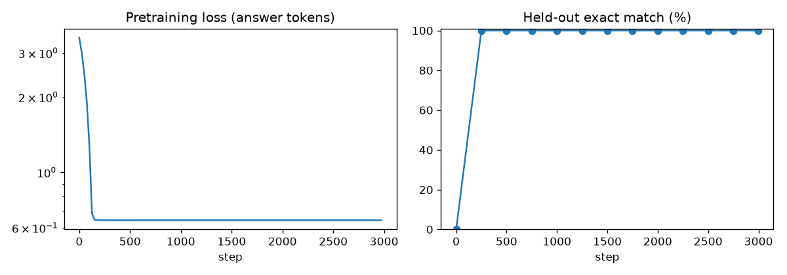
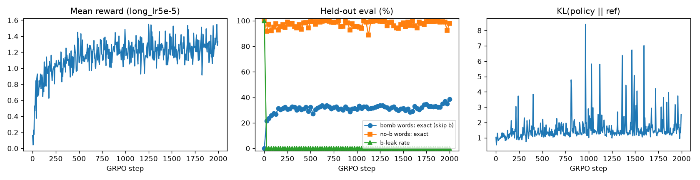
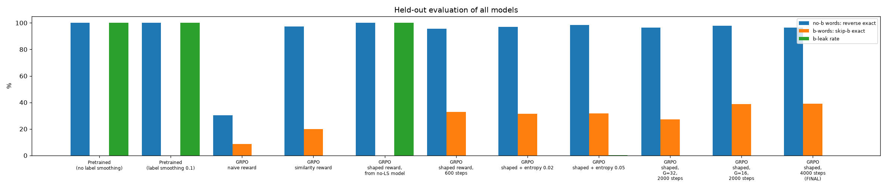

# Mini Project — Foundations of LLMs
## Training MiniGPT to reverse strings, then teaching it to skip "b" with GRPO

Step 1: Supervised pretraining from scratch
Step 2: RL fine-tuning (GRPO)
Step 3: Results and analysis

---

## Task overview

| Step | Input | Output |
|---|---|---|
| 1. Reverse | `<BOS> h e l l o <SEP>` | `o l l e h <EOS>` |
| 2. Reverse + skip "b" 💣 | `<BOS> a b c d e <SEP>` | `e d c a <EOS>` |

- Input length: 2–6 lowercase letters (random, not real words)
- Step 1 learns from labels (cross-entropy); Step 2 learns **only from a reward**

---

## 1. GPT model configuration

| Hyper-parameter | Value |
|---|---|
| Architecture | Decoder-only Transformer (GPT-2 style, pre-LayerNorm) |
| Vocabulary | 30 tokens = `<PAD> <BOS> <SEP> <EOS>` + `a`–`z` (char-level) |
| Context length (block size) | 15 = BOS + 6 + SEP + 6 + EOS |
| Layers / heads / embedding dim | 3 / 4 / 128 |
| MLP hidden | 512 (4×), GELU |
| Positional encoding | learned absolute |
| Weight tying | embedding ↔ output head |
| Dropout | 0 |
| **Parameters** | **600,832** |

---

## 2. Training & evaluation data

- **Training:** fresh random strings every step (768k examples total), any string in an eval set is rejected
- **Evaluation (fixed seed, held-out):**

| Set | Size | Purpose |
|---|---|---|
| `eval_reverse` | 1,350 (150 × len 2, 300 × len 3–6) | Step 1 accuracy, no-b retention |
| `eval_bomb` | 840 strings containing ≥1 "b" (40 × len 2, 200 × len 3–6) | Step 2 accuracy |

- **Loss masking:** loss only on answer tokens after `<SEP>` (input letters are random → unpredictable)
- **Metric:** exact match (every char + correct `<EOS>`), greedy decoding

---

## 3. Pretraining (Step 1) — setup & results

| Setting | Value |
|---|---|
| Optimizer | AdamW, lr 1e-3, warmup 200 → cosine, wd 0.01 |
| Batch / steps | 256 / 3,000 (≈104 s on CPU) |
| Label smoothing | **0.1** (needed for RL later) |

| Eval | Exact match |
|---|---|
| `eval_reverse` (all lengths 2–6) | **100.0%** (100% at every length) |
| `eval_bomb`, reverse task | 100.0% |
| `eval_bomb`, skip-b task | 0.0% (not trained yet) |

---

## 4. RL algorithm — GRPO

Per step:
1. Sample **32 prompts** (60% forced to contain "b")
2. Sample **G = 16** completions per prompt (T = 1.0)
3. Score each with the reward function
4. Group-relative advantage: $A_i = (r_i - \text{mean}_g) / \text{std}_g$ (no critic needed)
5. PPO-clipped objective (ε = 0.2), 2 updates per batch
6. KL penalty to the frozen pretrained model (β = 0.01, k3 estimator)

lr 5e-5 · AdamW · 4,000 steps total

---

## 5. Reward design — four iterations

| Version | Reward | What the model did |
|---|---|---|
| Naive | +1 if no "b" | **Reward hacking**: output garbage without b → reversal collapses to 30% |
| Similarity | SequenceMatcher ratio − 0.5·#b + 1·exact | Replaced b with "x": `mb → xm` |
| Prefix | correct-prefix / len − 0.5·#b + 1·exact | Stopped at the b: `mb → ""` |
| **Final (shaped)** | prefix − 0.5·#b − 0.5·\|Δlen\|/len + 1·exact; malformed = −1 | Learns to skip |

Target `edca` for input `abcde`:
`edcba` −0.03 · `edcxa` 0.48 · `edc` 0.63 · `edcaa` 0.68 · **`edca` 2.00** → every step toward the goal earns more

---

## 6. The exploration problem

- Pretrained **without** label smoothing → loss ≈ 0 → all 16 samples identical → advantage = 0 → **no learning**

| Correct "skip-b" answer appears when sampling | T=1 | T=1.5 | T=2 | T=3 |
|---|---|---|---|---|
| No label smoothing | 0.000% | 0.000% | 0.000% | 0.000% |
| Label smoothing 0.1 | **0.074%** | 0.060% | 0.015% | 0.060% |

- RL can only **amplify** behaviours the model already produces sometimes
- Later: **entropy collapse**, group std 0.6 → 0.05, and learning stalls

---

## 7. Fine-tuned model — results

| Model | No-b words | **b-words skip-b exact** | b-leak |
|---|---|---|---|
| Pretrained (LS 0.1) | 100.0% | 0.0% | 100.0% |
| GRPO naive reward | 30.3% | 8.7% | 0.0% |
| GRPO similarity reward | 97.3% | 19.9% | 0.0% |
| GRPO shaped, from no-LS model | 100.0% | 0.0% | 100.0% |
| GRPO shaped + entropy 0.05 | 98.4% | 31.7% | 0.1% |
| GRPO shaped, G=16, 2k steps | 97.9% | 38.7% | 0.0% |
| ⭐ **GRPO shaped, 4k steps (final)** | **96.5%** | **39.0%** | **0.0%** |

By length (final): len 2 **97.5%** · 3 56.5% · 4 38.5% · 5 27.5% · 6 22.0%

---

## Training curves (GRPO, shaped reward)

- b-leak drops 100% → 0% within ~25 steps
- skip-b accuracy rises fast to ~30%, then plateaus near 40%

---

## All models

---

## 8. Discussion — error analysis

Typical remaining errors: the model **skips the b but does not shift its copy pointer**

| Input | Target | Output |
|---|---|---|
| `gob` | `og` | `oo` |
| `hqbs` | `sqh` | `sqq` |
| `jbqis` | `siqj` | `siqi` |

- Reversal is learned as **position-based copying** (output k ← input L+1−k)
- Skipping b needs a **new, content-dependent algorithm** (count b's seen so far)
- Each extra position that must shift is another rare event to discover → accuracy falls with length
- Doubling training (2k → 4k steps) gave +0.3 pts → a ceiling of the method, not under-training

---

## 8. Discussion — key findings

1. **Reward hacking is the default:** each loophole (any non-b, replace b, stop early) was found
2. **Shaped, dense rewards matter:** shaped 39% > similarity 20% > naive 9%
3. **RL needs exploration:** a model that is 100% confident cannot be improved by RL (0%)
4. **Pretraining choices shape RL:** label smoothing 0 → 0.1 moved RL result 0% → 39%
5. **KL anchor preserves old skills:** no-b reversal stays ~97% with the shaped reward
6. **Entropy bonus** keeps diversity but random noise ≠ useful exploration

**Next steps:** SFT cold-start before RL (as in DeepSeek-R1), length curriculum, token-level rewards, larger model

---

# Thank you

Code: `common.py`, `train_pretrain.py`, `train_grpo.py`, `evaluate_all.py`
Results: `results/summary.md`, `results/*.png`
